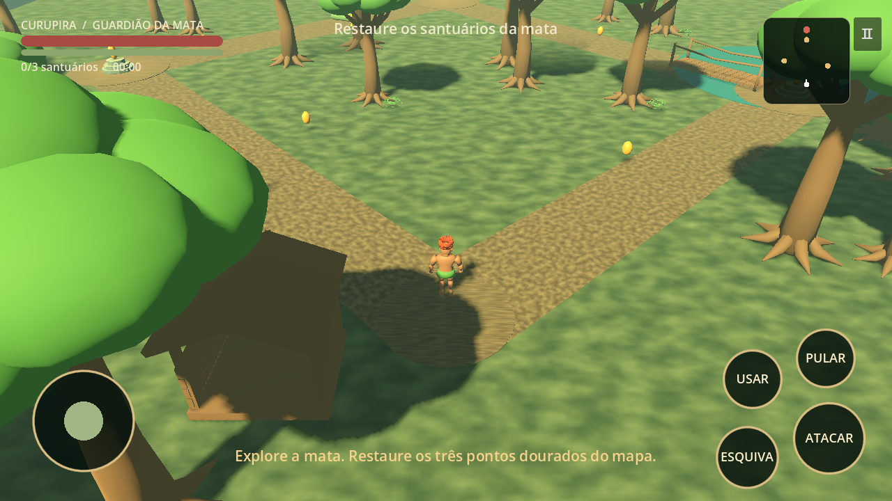

# Ratanabá Guardians — versão 2D RPG

A nova versão 2D está em [ratanaba-2d/](ratanaba-2d/).

**[Baixar APK 2D 0.5.1 para Android](downloads/ratanaba-guardians-2d-v0.5.1-debug.apk)** · [Instalação e SHA256](downloads/README-ratanaba-2d.md) · [Código e testes](ratanaba-2d/README.md)

Três áreas, Curupira, sprites com novas ações, combate elemental, mochila, raridades, mana e evolução por aura. O APK contém a versão web0.5 em um aplicativo Android offline. É uma build de teste; não houve teste em aparelho Android físico.

---

# Guardiões da Mata — v0.1.0

Primeira versão jogável de uma aventura 3D offline do folclore brasileiro,
feita com **Godot 4.6.3** e modelos originais criados no **Blender 4.3.2**.

Controle o Curupira, conheça Saci e Iara, restaure três santuários, escape do
Boitatá e derrote a Cuca. Há combate, cura, coleta, vitória, derrota, nova
partida, pausa, áudio e melhor tempo salvo no aparelho.



**Arte inicial:** os modelos são simplificados, com rigs por segmentos e materiais
básicos. Ainda não têm o acabamento fotorealista das imagens de conceito da
conversa. Esta entrega é uma base jogável para continuar a produção.

## Baixar e jogar no Android

**[Baixar APK v0.1.0](https://github.com/mizaelcosta1/codex/raw/refs/heads/main/downloads/guardioes-da-mata-v0.1.0.apk)**

[SHA256 e instruções](downloads/README.md) · [Validação executada](docs/VALIDACAO.md)

1. Baixe o APK no celular e abra o arquivo.
2. Se o Android solicitar, permita a instalação pela aplicação que abriu o APK.
3. Abra **Guardiões da Mata** e toque em **ENTRAR NA MATA**.

Requisitos declarados: Android **7.0/API 24+**, OpenGL ES **3.0**, CPU **ARM64**
ou **x86_64**. ARM de 32 bits não está incluído. Esses requisitos não representam
uma garantia de desempenho em todos os aparelhos. O APK é uma versão de testes
assinada com chave de depuração; não é uma publicação na Play Store.

| Controle | Função |
|---|---|
| Joystick à esquerda | Mover |
| ATACAR | Golpe frontal; consome energia |
| ESQUIVA | Avanço rápido e invulnerabilidade curta |
| PULAR | Pula quando está no chão |
| USAR | Conversar e restaurar santuários próximos |
| Ⅱ / Voltar do Android | Pausar e retomar |

Os pontos dourados do minimapa são os santuários. Restaure os três para remover
a proteção da Cuca. Depois, acerte seis golpes nela. A Iara cura a cada 30 s;
sementes douradas recuperam vida. Movimento e ações aceitam dedos separados.

## Abrir o projeto

Instale Godot **4.6.3 padrão** (não requer .NET). No gerenciador de projetos,
importe `project.godot` e execute com F6/F5 conforme a cena/projeto. Pelo terminal:

```sh
godot --path . --editor
godot --path .
```

No PC: WASD ou setas para mover, J para atacar, K para esquivar, espaço para pular,
E para interagir e Esc para pausar. Não existem backend, anúncios, compras ou
chaves de API. A partida funciona sem Internet.

## Modelos e cena

- `assets/models`: Cuca, Saci, Curupira, Iara, Boitatá, árvore, pedra, samambaia,
  altar, ponte, cabana e semente, em GLB.
- `art_source/folclore_assets.blend`: fontes editáveis, uma cena `FOL_*` por asset.
- Quatro humanoides com clips Idle, Walk e Attack. Boitatá move-se pela lógica
  do inimigo; não tem rig esquelético nesta versão.
- `scenes/main.tscn`: entrada do jogo. `scripts/game.gd` monta o mapa de gameplay.
- `scenes/map_preview.tscn`: cópia estática gerada para inspecionar no editor;
  alterações nela não mudam automaticamente o mapa montado pelo código.
- `assets/audio`: ambiente e quatro efeitos sintetizados originais.
- O HUD usa controles reais, não uma imagem estática de interface.

## Regenerar e testar

Faça uma cópia das edições manuais antes de regenerar os assets:

```sh
blender --background --factory-startup --python tools/build_assets.py
python3 tools/build_audio.py
python3 tools/validate_assets.py
godot --headless --path . --editor --import --quit
godot --headless --path . --fixed-fps 60 --script res://tests/test_game.gd
```

O teste funcional retorna código diferente de zero se alguma verificação falhar;
os relatórios atuais são gravados em `build`. Capturas reais da engine:

```sh
godot --path . --audio-driver Dummy --script res://tests/capture.gd
# Recriar a cópia estática do mapa:
godot --headless --path . --script res://tools/export_map.gd
```

O driver de áudio Dummy só é útil em máquinas sem saída de áudio. Não o use para
avaliar o som no computador. Detalhes de teste e limitações estão em
[VALIDACAO](docs/VALIDACAO.md).

## Compilar outro APK

Instale os templates oficiais **4.6.3.stable**, JDK e Android SDK, e configure os
caminhos em Editor Settings → Export → Android. O preset `Android` usa exportação
direta do template, sem Gradle/NDK, para ARM64 e x86_64:

```sh
mkdir -p build # No Windows, use: New-Item -ItemType Directory -Force build
godot --headless --path . --export-debug Android build/guardioes-da-mata-debug.apk
```

Nesta nuvem, `tools/godot.sh` usa os diretórios de ferramentas em `/workspace`.
Em outra máquina, use o comando Godot normal e seus caminhos locais. A chave de
depuração fica fora do projeto. Para distribuição comercial, configure sua própria
chave release e mantenha-a fora do Git. O preset não solicita permissão de Internet.

## Próximas versões

Refinar escultura e retopologia, texturas PBR, pesos suaves e animações; enriquecer
água/vegetação e iluminação; implementar navegação que contorne obstáculos;
medir FPS, memória e consumo em aparelhos físicos. A IA atual segue direções
locais e pode encostar em obstáculos.

[Arquitetura](docs/ARQUITETURA.md) · [Inventário](docs/assets_manifest.json) ·
[Créditos](docs/CREDITOS.md)
